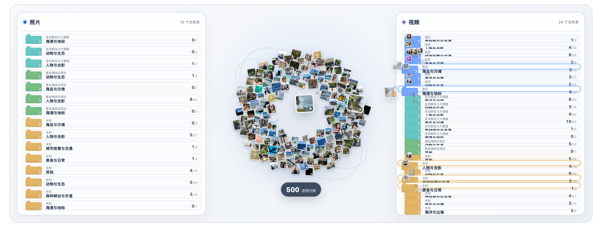
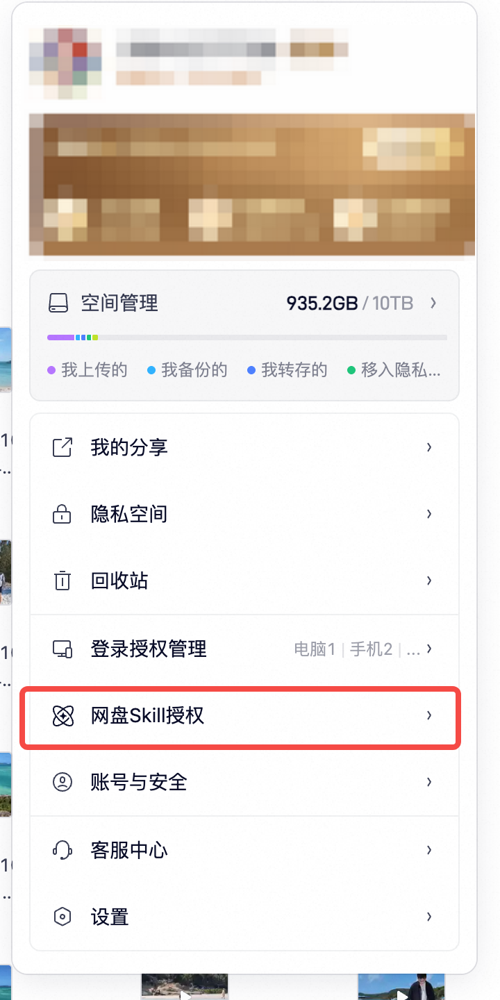
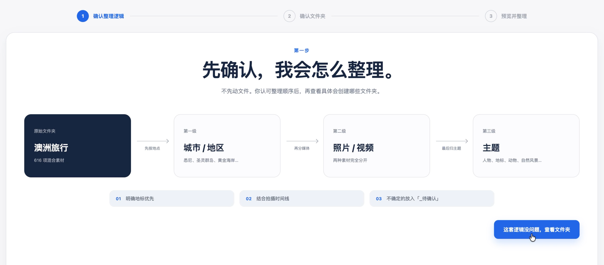
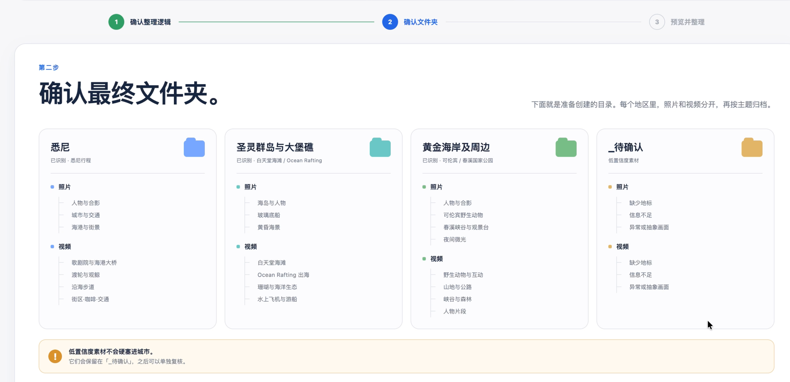
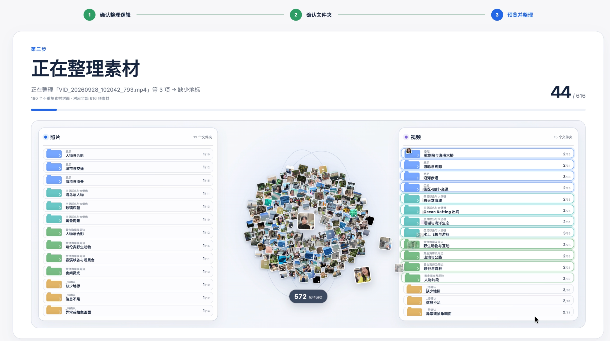
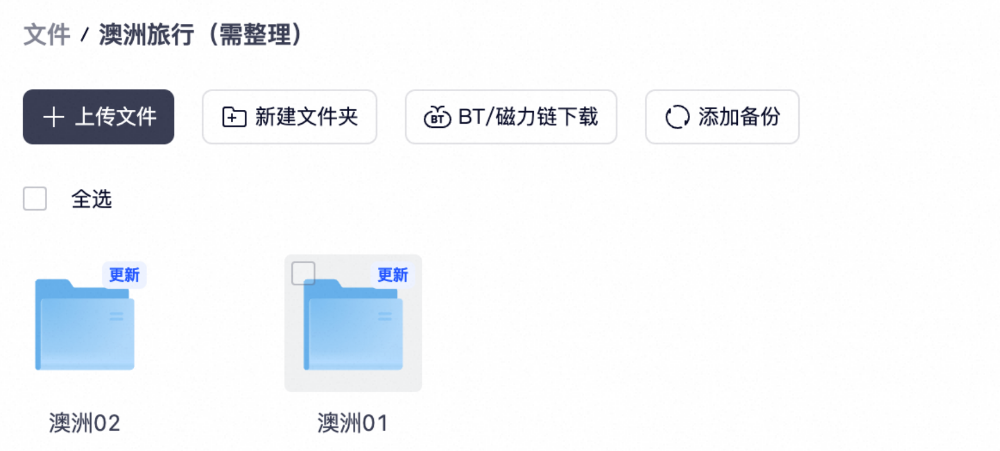
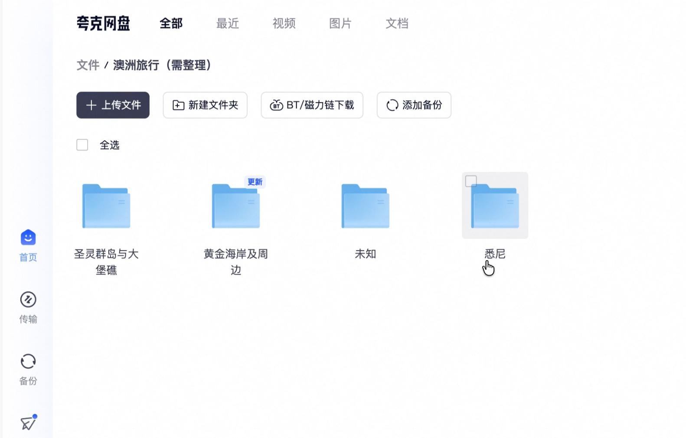

# 整理网盘文件

## 1. 这个 Skill 是干嘛的

把杂乱的夸克网盘相册整理成清楚的文件夹，并用一个 HTML 网站展示规划、确认和整理过程。

Agent 会先读取你指定的文件夹，分析真实照片、视频和其他素材，提出分类方案。旅行素材可以按「地点 → 照片 / 视频 → 主题」整理；其他相册会根据实际内容规划，不固定城市、数量，也不要求一定有视频。

你可以先确认整理思路和目录，再观看真实素材封面从照片星球飞入两侧文件夹的预览。最后正式确认，Agent 才会真正操作网盘，并把实际结果显示在页面上。

*以下截图展示一次旅行相册的使用过程。实际照片、地点、主题和数量都会根据你自己的素材生成；动画预览与真实网盘整理分开进行。*

## 2. 如何使用这个 Skill

### 使用前：安装 Skill，完成夸克网盘授权

需要 Node.js 20+，以及支持本地 Skill 和命令执行的 Agent。你可以直接告诉 Codex：

> 请安装这个 Skill：https://github.com/panggungunvibe/organize-cloud-drive-files

也可以[下载整理 Skill 安装包](https://github.com/panggungunvibe/organize-cloud-drive-files/releases/latest)，解压后将 `organize-cloud-drive-files` 文件夹放入 Agent 的全局 Skills 目录，再重新载入 Skills。

这个整理流程需要配合**夸克网盘官方 Skill** 使用。可从[官方 Skill 下载地址](https://pdds.quark.cn/download/stfile/eekkigineefiegmgo/quarkclouddrive-1.0.25.zip)获取，或把该链接发给 Agent，让它安装并引导授权。

**在哪里找到授权入口？** 打开夸克网盘的头像 / 账号菜单，找到「网盘Skill授权」，即下图红框位置，再按授权页和 Agent 的提示完成账号连接。

整理 Skill 会先检查官方 Skill 是否安装、账号是否连接；已经连接时继续选择文件夹，未连接时先引导授权。

### 第一步：指定文件夹，确认整理思路

安装并授权后，直接对 Agent 说：

> 使用 $organize-cloud-drive-files，帮我整理夸克网盘里的「我的旅行相册」。先让我确认分类方案，再真正整理。

没有指定文件夹时，Agent 会先询问你。它会读取实际素材，在 HTML 页面展示数量、容量和建议的整理顺序，让你先确认「准备怎么整理」。

例如，旅行相册可以先分城市 / 地区，再分照片和视频，最后归入画面主题。证据不足的素材单独放入「未知」或「_待确认」，具体以本次方案为准。

确认思路后，点击「这套逻辑没问题，查看文件夹」，进入目录方案。

### 第二步：确认最终目录框架

页面会展示准备建立的文件夹，以及各目录下照片、视频和主题的归属。你可以在这里核对分类名称和层级，再决定是否接受。

确认后，点击「确认文件夹，预览整理过程」。

### 第三步：观看整理动画

真实素材封面会组成一个密集的照片星球，再逐渐飞入两侧最末级文件夹。素材较多时展示不重复的代表封面，完整方案仍覆盖全部素材。

**这一步是归类预览。** 动画播放结束，不代表网盘已经整理完成；重播动画也不会重复执行网盘操作。

### 第四步：正式确认，查看网盘整理结果

动画结束后，点击「正式确认以上归类，开始整理网盘」，Agent 才会按已确认的方案真实整理。移动或复制以最终确认的方案为准，默认保留原文件名。

支持当前对话通知的 Codex 环境会直接把网页确认发送给 Agent；其他环境会提供可复制的指令，按页面提示发回当前 Agent 即可。

执行后，网页会回写真实结果，并提供网盘结果入口。你也可以打开夸克网盘，查看文件夹的实际变化。

#### 整理前

素材放在「澳洲01」「澳洲02」等原始目录中。

#### 整理后

网盘中已建立按城市 / 地区归类的目录，再向下区分媒体类型和主题；不确定的素材单独归档。下图是这次旅行素材整理后的实际目录。

---

MIT License · 配合夸克网盘官方 Skill 使用的独立工作流。
