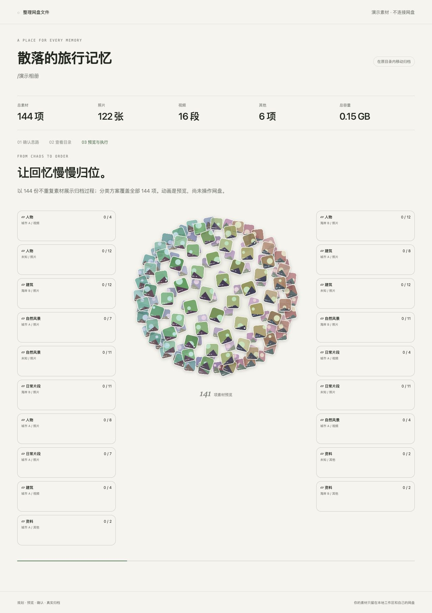

# 整理网盘文件

一个配合 **夸克网盘官方 Skill** 使用的开源 Agent Skill：从杂乱素材中生成分类方案，在本地 HTML 页面确认、观看素材星球归档预览，再由 Agent 真正整理网盘。

不限定旅行城市、相册规模或媒体类型。只有照片、包含视频、混合其他文件的文件夹都可以先分析再规划。



## 安装与使用

需要 Node.js 20+、支持本地 Skill 和命令执行的 Agent，以及已安装并授权的[夸克网盘官方 Skill](https://pdds.quark.cn/download/stfile/eekkigineefiegmgo/quarkclouddrive-1.0.25.zip)。账号授权、权益和接口能力以夸克官方为准；本项目不包含官方 CLI 或账号凭据。

在 Codex 中可以直接说：

> 请安装 https://github.com/panggungunvibe/organize-cloud-drive-files 这个 Skill。

或下载[安装包](https://github.com/panggungunvibe/organize-cloud-drive-files/releases/latest)，把其中 `organize-cloud-drive-files` 文件夹放入 Agent 的全局 Skills 目录。也可将仓库克隆到 Codex 默认目录：

```sh
git clone https://github.com/panggungunvibe/organize-cloud-drive-files.git ~/.codex/skills/organize-cloud-drive-files
```

安装后重新载入 Skills，告诉 Agent：

> 使用 $organize-cloud-drive-files，帮我整理夸克网盘里的一个文件夹。先检查连接，让我确认分类方案，再真正执行。

## 流程

1. 检查官方 Skill 和账号连接；未连接时按官方流程授权。
2. 询问目标文件夹，读取实际文件清单并逐项分类。
3. 展示真实素材统计、整理思路和目标目录，请用户逐步确认。
4. 播放不重复的代表素材组成的星球向两侧最末级文件夹归位的动画。
5. 动画结束后，显示「正式确认以上归类，开始整理网盘」。
6. 用户点击后，Agent 使用官方精确整理任务执行，网页读取实际结果并提供网盘结果入口。

**动画只是预览。** 页面不会因为动画结束就显示网盘整理成功。目标目录、文件名、移动/复制方式与逐文件映射在最终确认时冻结；刷新、重播和重复点击不会重新执行。

默认建议在原目录内移动归档、保留原名；用户可选择其他方式。精确复制取决于已安装官方接口的能力，不支持时应说明并重新选择，不能擅自改成移动。不自动删除、去重或整理用户范围之外的文件。

## 网页如何通知 Agent

支持现有会话队列的 Codex 环境使用 `codex queue --thread … --message …`。通道、会话来自当前真实环境，不能假设所有 Agent 都提供这一能力。

不支持自动通知时，网页明确显示「确认已保存，请把指令发送到当前 Agent」，提供复制按钮；用户需要发送一次。网页服务器本身不运行夸克写操作，也不会把“已保存”说成“Agent 已收到”。

## 离线体验

```sh
npm run demo
```

打开终端实际输出的本地地址。演示包含 144 张互不相同的抽象样张，均标有 SAMPLE；**演示按钮不能发送 Agent 指令或操作网盘**。不需要网盘授权，也不需要安装 npm 依赖。

## 模板与验证

- [Skill 入口](SKILL.md)：Agent 工作流程。
- [方案格式](references/plan-schema.md)：逐文件映射和真实结果状态。
- [夸克流程衔接](references/quark-workflow.md)：范围、内容理解、官方校验和执行。
- [网页通知通道](references/agent-bridge.md)：自动队列与手动降级。
- `assets/web/`：HTML、CSS 和密集素材星球动画。
- `scripts/`：连接检查、私有工作区、方案导入、本地服务和结果回写。

```sh
npm test
npm run package
```

测试只使用虚构数据和本地 HTTP 服务，不访问网盘。打包脚本仅收集 Skill 必需文件，不包含运行数据。Windows 可直接下载 GitHub Release 安装包；本地打包需要 `zip` 命令。

工作区的 `private/` 保存方案、确认和原始任务引用；`public/thumbs/` 保存用户缩略图。两者都属于用户私有运行数据，**不要提交或公开部署整个工作区**。本地服务仅监听 `127.0.0.1`，不加载远程统计或 CDN。

MIT License。本项目为独立工作流，非夸克官方产品。
